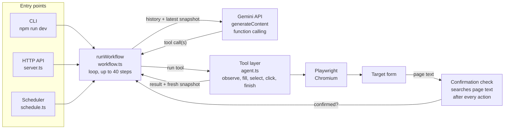

# Design notes

This document explains why the agent is built the way it is. For setup and usage, see the [README](README.md).

## Architecture

How one run works:

1. The agent opens the form in Chromium using Playwright.
2. `agent.ts` turns the page into a short list of the visible interactive elements. Each element gets a temporary reference (`e1`, `e2`, …), its label, its current value and, for dropdowns, its options. The model never sees the HTML.
3. Gemini receives that list and the values to enter, and uses function calling to choose an action, such as `fill e2 "John"` or `click e7`.
4. The tool layer resolves the reference to a Playwright locator and performs the action. After a `fill`, it reads the value back and reports a warning if it does not match.
5. The tool result and a fresh snapshot go back to the model, and the loop repeats.
6. The model calls `finish` when it believes the form has been submitted.
7. Independently of the model, the code searches the page text for confirmation words ("success", "submitted", "thank you", "confirmation", "received") after every action.

A run is reported as successful only when the model calls `finish(success: true)` **and** confirmation text was found on the page. If the model reports success but no confirmation was seen, the run is treated as a failure.

## Problem

Filling the same web form repeatedly is slow, and scripted automation usually depends on hardcoded selectors that break when the page changes. This project fills a multi-section medical intake form from structured data, without page-specific selectors.

## Motivation

Filling a field is easy. The harder question is how to know the task actually finished. A browser agent can report success when a value did not go in, or when the form was never submitted. For forms such as medical or financial ones, a silent failure is worse than no automation. The design therefore checks the agent's work rather than trusting its final message.

## Simpler options considered

| Option | Why it was not used |
|---|---|
| Fixed Playwright script with CSS selectors | Faster and cheaper, but breaks when IDs or layout change, and has to be rewritten for each form. For one stable form, this would be the better choice. |
| Sending raw HTML to the model | Uses far more tokens and leaves the model guessing at brittle selectors. |
| Screenshots with a vision model | Slower, and less precise about which element is being acted on. |

## Design decisions

- **Observe and act loop.** One model request per step. The result of each action and the updated page go back to the model before its next request. The loop executes every tool call in a response, so it does not strictly enforce one action per step.
- **Simplified snapshot.** Only visible inputs, selects, text areas, buttons and links are included. This keeps prompts small and avoids exposing selectors to the model.
- **References regenerated after every action.** Opening or closing a section changes the page, so old references are stale. Each tool returns a fresh snapshot, which saves a separate `observe` call.
- **Five tools.** `observe`, `fill`, `select`, `click` and `finish`.
- **Checks outside the model.** Read-back after every fill, and a confirmation check that does not depend on the model's output.
- **Deterministic settings.** Temperature 0 and a 40-step cap to limit cost and make runs more repeatable.
- **Three ways to run.** A CLI, an HTTP API that rejects unknown fields with `400`, and a scheduler that skips a run if the previous one is still in progress.

## Problems the design handles

- **Stale references.** After a click, previous references can point to the wrong element. Every action returns a new snapshot, and the system prompt tells the model that old references are invalid.
- **Collapsible sections.** Opening one section closes the others. The prompt tells the model that closed sections keep their values, so it does not reopen them to check.
- **Date fields.** The field displays `mm/dd/yyyy` but expects `YYYY-MM-DD`.
- **Dropdown placeholders.** Options such as "Select gender" must never be chosen.
- **Values that do not stick.** Read-back catches these immediately instead of at submit time.
- **Temporary confirmation message.** It can disappear, so the page is checked after every action and the first match is kept.
- **Gemini thought signatures.** Gemini 3 requires response parts to be passed back unchanged, or later tool calls fail. The workflow preserves them.

## Evaluation

Each run reports:

- whether it succeeded (model `finish` plus confirmation found on the page)
- the confirmation text that was found
- the number of steps
- the duration

There is no test set yet, so there is no measured success rate. The confirmation check is a keyword search of the page text, not a check of a specific success element.

## Trade-offs

- **Small steps instead of batching many actions.** The model sees the page after each response, which is slower and uses more API calls. On the free tier this shows up as rate limits.
- **Form-specific prompt rules instead of a fully general agent.** More reliable on this form, less general.
- **Keyword confirmation instead of a precise check.** Simple, but a word like "success" could appear on a page for other reasons.
- **Direct REST calls instead of an SDK.** Full control over thought signatures, but tied to Gemini's request format.

## Next steps

- Build a set of about 10 local test forms (tricky dropdowns, date pickers, validation errors, fields that move) and measure the success rate before and after each change.
- Replace the keyword search with a check for a specific confirmation element.
- Enforce one action per model response, or document that several are allowed.
- Ask a human to approve before any irreversible submission.
- Retry with backoff on rate limits and page timeouts.
- Generalise the system prompt so it is not tied to one form.
- Add a Docker image and protect the HTTP endpoint with an API key.